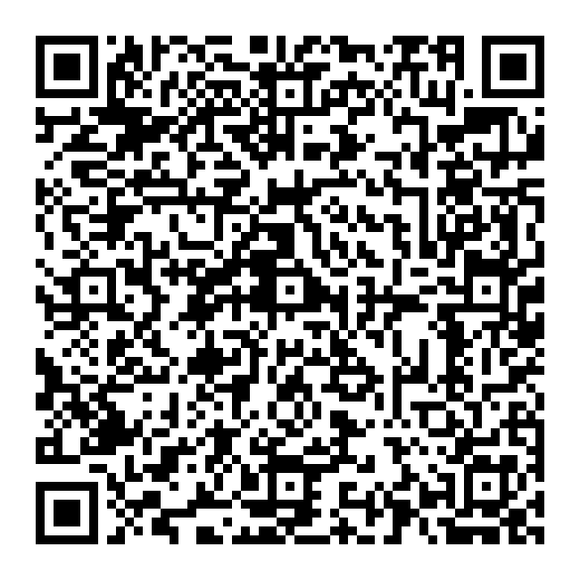

# QR-Code auf der Rapportkarte

Die Tagesrapport-App liest den QR-Code auf der Rapportkarte automatisch, ohne Antippen, und übernimmt die Auftragsdaten fehlerfrei. Was nicht im QR-Code steht, ergänzt sie per Texterkennung.

## Format (festgelegt, Stand Oktober 2026)

Ein Eintrag je Feld, getrennt durch `;`, jeweils `Schlüssel - Wert`:

```
Kunde -  Mustermann | Kundenname folgt ! ; Straße - Niemandslandstr. 1 ; PLZ Ort - 68229 Mannheim ; Auftragsnr -  A26333 ; Auftragsbez Testauftrag ; Pos -   ; Posbez
```

| Schlüssel im QR-Code | Feld in der App | Pflicht in Schritt 1 |
|---|---|---|
| `Kunde` | Kunde | ja |
| `Straße` | Straße und Hausnummer | ja |
| `PLZ Ort` | PLZ, Ort | ja |
| `Auftragsnr` | Auftrag | ja |
| `Auftragsbez` | Bezeichnung (Auftrag) | nein |
| `Pos` | Position | ja |
| `Posbez` | Bezeichnung (Position) | nein |

Die App ist tolerant:
- Als Trennzeichen gehen `-`, `=`, `:` oder gar keins (wie bei `Auftragsbez Testauftrag`).
- Mehrfache Leerzeichen und Groß-/Kleinschreibung sind egal.
- Leere Werte (`Pos -   ;`) werden ignoriert.

Zusätzlich verstanden, falls später ergänzt: `Kundennr`, `Tel`, `Projekt` sowie das ältere Format mit `=` und Zeilenumbrüchen oder JSON.

## Ablauf in der App

- **`Pos` gefüllt:** Alle Pflichtfelder stehen im QR-Code. Die App übernimmt sie in unter einer Sekunde, ohne Texterkennung. Schritt 1 zeigt „QR-Code“. Kunden-Nr. und Telefon bleiben leer, weil sie nicht im Code stehen, und können von Hand ergänzt werden.
- **`Pos` leer (wie im Beispiel):** Die App übernimmt die QR-Felder und liest Position, Kunden-Nr. und Telefon per Texterkennung dazu. Das dauert ein paar Sekunden. Schritt 1 zeigt dann „Bitte mit der Karte vergleichen“.

Getestet mit dem echten QR-Code auf dem Nachbau der Karte: alle 9 Felder richtig.

## Beispiel zum Testen



`qr-beispiel.png` enthält Ihr Format mit ausgefüllter Position (`Pos - A26333-01 ; Posbez Rapportposition Test`). Ausgedruckt (≈ 35 mm) oder am Bildschirm gezeigt, füllt die App Schritt 1 sofort aus und zeigt „QR-Code“.

## Druck

- **Größe:** mindestens **30 × 30 mm**, sonst erkennen ältere Handys ihn aus normalem Abstand nicht sicher.
- **Ruhezone:** rundherum weißer Rand von mind. 4 Modulen, keine Linien oder Text im Rand.
- Schwarz auf Weiß, nicht auf farbigem Hintergrund.
- Codierung UTF-8, damit `ß` und Umlaute stimmen.

Technische Umsetzung in der App: `src/lib/qr.ts` (Format) und `src/lib/scanner.ts` (Erkennung).
