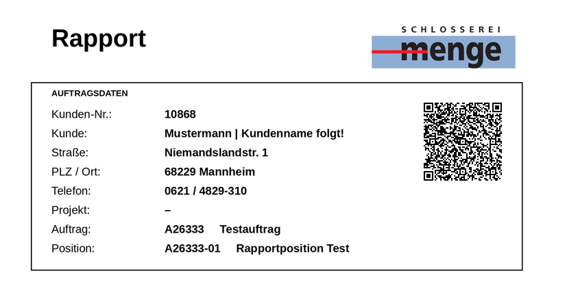

# Rapportkarte: Gestaltung für sichere Erkennung

Anleitung für das Programm, das die Rapportkarte (Laufkarte) druckt. Mit diesen Regeln liest die Tagesrapport-App die Auftragsdaten per Kamera deutlich zuverlässiger – auch ohne QR-Code.

## Gemessen

Gleiche Testbedingungen für beide Karten: sechs simulierte Handyfotos (iPhone/Android, gut, unscharf, schräg, dunkel mit Schatten, zu weit weg), je 9 Felder.

| | bisherige Karte | Vorschlag |
|---|---|---|
| Felder richtig erkannt | 44 von 54 | **52 von 54** |
| Kundenname richtig | 1 von 6 | **5 von 6** |
| Fotos, bei denen alles stimmt | 1 von 6 | **5 von 6** |

Mit QR-Code im Scanfeld werden alle Felder immer fehlerfrei übernommen (siehe [QR-Code-Rapportkarte.md](QR-Code-Rapportkarte.md)). Die Texterkennung ist dann nur noch Rückfall.

## Regeln

1. **Ein Scanfeld oben auf der Karte.** Alle Angaben, die die App lesen soll, stehen zusammen in einem Kasten unter dem Kopf – ca. 18 × 7 cm. Der Mitarbeiter hält genau diesen Kasten in den Sucher.
2. **Eine Angabe pro Zeile, „Beschriftung: Wert“.** Die App sucht diese Beschriftungen (genau so geschrieben):

   | Beschriftung | Wert |
   |---|---|
   | `Kunden-Nr.:` | 10868 |
   | `Kunde:` | Mustermann GmbH |
   | `Straße:` | Niemandslandstr. 1 |
   | `PLZ / Ort:` | 68229 Mannheim |
   | `Telefon:` | 0621 / 4829-310 |
   | `Projekt:` | (leer oder `–`) |
   | `Auftrag:` | A26333 ␣␣␣ Testauftrag |
   | `Position:` | A26333-01 ␣␣␣ Rapportposition Test |

   Bei Auftrag und Position: erst die Nummer, dann mit deutlichem Abstand (mind. 3 Leerzeichen) die Bezeichnung.
3. **Kundenname in einer Zeile, nie umbrechen.** Die schmale Namensspalte der bisherigen Karte („Musterman-n“ über vier Zeilen) ist die häufigste Fehlerquelle. Lieber kürzen als umbrechen.
4. **Schrift:** Arial/Helvetica (oder ähnlich), **mindestens 11 pt, besser 12 pt**. Werte fett, Beschriftungen normal, beides **schwarz**. Keine kleinen grauen Beschriftungen – „Kunde:“ in Grau ging auf Handyfotos regelmäßig verloren.
5. **Im Scanfeld nur Schwarz auf Weiß.** Keine farbigen Flächen oder Markierungen (der rote Balken hinter „Rapport“ mit blauer Schrift, rot hinterlegtes „Ausgeführte Arbeiten“). Farbe wird im Kamerabild zu grauen/schwarzen Flecken.
6. **Keine Linien dicht an der Schrift.** Keine Tabellenlinien zwischen Beschriftung und Wert. Der Rahmen um das Scanfeld mit **mind. 5 mm Abstand** zum Text – sonst verschluckt die Erkennung den ersten Buchstaben.
7. **Logo außerhalb des Scanfelds** (darüber), nicht neben den Adressdaten. „SCHLOSSEREI menge“ wird sonst als Text mitgelesen.
8. **QR-Code rechts im Scanfeld**, mind. 30 mm, mit weißem Rand. Inhalt siehe QR-Anleitung.
9. **Druck:** Laserdrucker, mattes Papier, ohne „An Seite anpassen“-Verkleinerung.

Der Rest der Karte (Ausgeführte Arbeiten, Material, Stunden, Unterschriften) kann bleiben, wie er ist – die App liest nur das Scanfeld.

## Was die App automatisch erkennt

- Steht ein **QR-Code** mit Auftragsdaten auf der Karte → wird sofort übernommen, ohne Texterkennung.
- Findet die App die Beschriftungen **„Straße:“ / „PLZ / Ort:“ / „Kunden-Nr.:“** → liest sie die Karte im neuen Formular-Layout.
- Sonst → bisherige Karte (Spaltensuche über die Postleitzahl).

Alte und neue Karten funktionieren also nebeneinander, eine Umstellung ist jederzeit möglich.

Umsetzung in der App: `src/lib/cardParser.ts` (`leseFormular`), Messung: `scripts/bench/ocr-bench.ts`.
